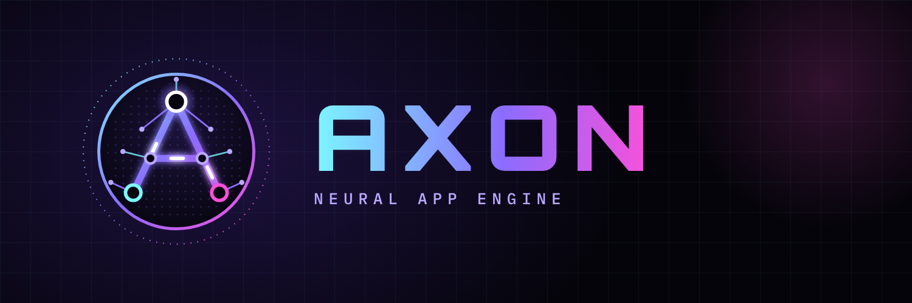
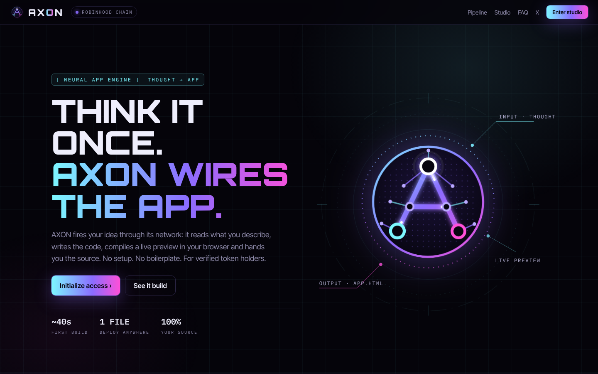
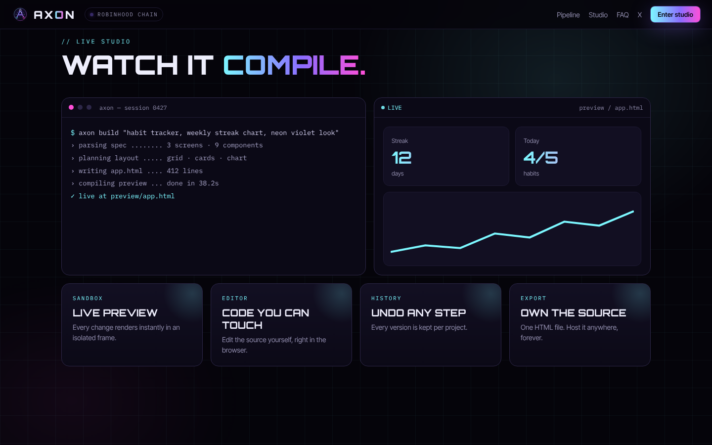

<p align="center">
  
</p>

<p align="center">
  <b>Think it once. AXON wires the app.</b><br />
  A prompt-to-app AI studio for token holders on Robinhood Chain.
</p>

<p align="center">
  <a href="https://useaxon.xyz">Live site</a> ·
  <a href="#how-it-works">How it works</a> ·
  <a href="#run-it-yourself">Run it yourself</a> ·
  <a href="https://x.com/Useaxonxyz">X @Useaxonxyz</a>
</p>

---

## What is AXON?

AXON turns one sentence into a working web app. Describe what you want, and the AXON agent
writes the code, compiles a live preview in your browser and hands you the source.

Access is token-gated: wallets that hold the AXON token on **Robinhood Chain** unlock the studio.

<p align="center"></p>

## How it works

| Step | What happens |
|---|---|
| **01 · Prompt** | Describe the app: screens, colors, how it should feel. |
| **02 · Compile** | The agent plans the layout and writes HTML, CSS and JavaScript. |
| **03 · Preview** | The app runs live in a sandbox while the code streams in. |
| **04 · Ship** | Refine it, undo any step, then download one deploy-ready file. |

<p align="center"></p>

## Features

- **Wallet sign-in on Robinhood Chain**: MetaMask, Rabby or any EVM wallet. Sign a free message, no transaction, no gas.
- **Token gate**: the server reads the ERC-20 balance on chain before opening the studio.
- **AI studio**: chat with the agent, edit the code yourself, live sandboxed preview, projects, undo, download.
- **Holder tiers**: Signal, Synapse and Cortex. The more tokens a wallet holds, the more builds a day.
- **Templates**: start from a working game, dashboard, tracker or token page and remix it by chatting.
- **You own the output**: every app is a single HTML file you can host anywhere.

## Tech

- Static front end: HTML, CSS and vanilla JavaScript, no build step
- Serverless API on Vercel (`api/`): sign-in, balance check, agent
- [viem](https://viem.sh) for signature checks and on-chain reads
- [Claude](https://www.anthropic.com/claude) (Anthropic API) powers the agent, streamed to the browser

```
index.html, app.js, home.js   landing page
studio.html, studio.js        the studio
templates/                    ready-made apps (game, dashboard, tracker, token page) to remix
gate.js                       wallet sign-in (Robinhood Chain)
config.js                     social links
styles.css, assets/           look and logo
api/                          serverless API (auth, balance, agent)
server.mjs                    local dev server
```

## Run it yourself

```bash
npm install
cp .env.example .env    # fill in ANTHROPIC_API_KEY and SESSION_SECRET
npm run dev             # http://localhost:3000
```

Deploy on Vercel: import the repo, framework preset **Other**, no build command, then add the
environment variables from `.env.example`. Leave `TOKEN_ADDRESS` empty to run in demo mode
(every wallet can enter).

## Security

- No keys live in this repository. API keys and secrets are set as environment variables.
- Sign-in uses a one-time signed message. AXON never asks for a seed phrase or a transaction to log in.
- Generated apps run in a sandboxed iframe.
